<div align="center"></div>
<h1 align="center">ULS Academics</h1>
<p align="center">
  
  
  
  
  
  
</p>
<p align="center">
  <b>Download v0.2.0:</b>
  <a href="https://github.com/johnsonmiguel18/uls-academics/archive/refs/tags/v0.2.0.zip">Source (.zip)</a> |
  <a href="https://github.com/johnsonmiguel18/uls-academics/releases">All releases</a>
</p>

The standalone Academics website of the University of La Salette, with its own CMS
(Filament admin at `/admin`), its own database and its own users. It runs next to the
main university website (University Website v5), which is not changed.

> **Current version: v0.2.0**: a news front page in the style of a news site (lead story with three headlines,
> story cards that swipe on phones, a "More headlines" column, SDG labels and a Goals filter); admin tables as
> data grids and a three-pane news editor with a desktop and phone preview; security headers; screen reader,
> keyboard and small-screen fixes; photo thumbnails made ahead of time.
> See [Releases](https://github.com/johnsonmiguel18/uls-academics/releases) for the release notes.

<p align="center">
  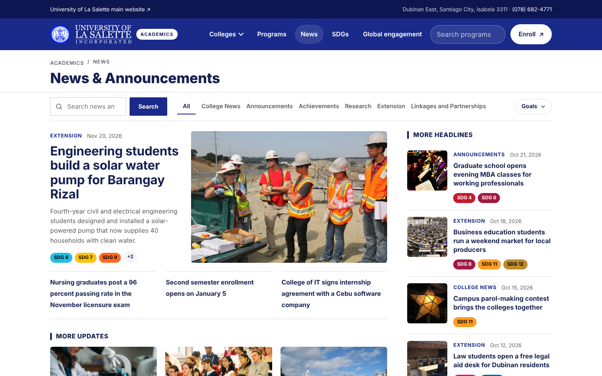
  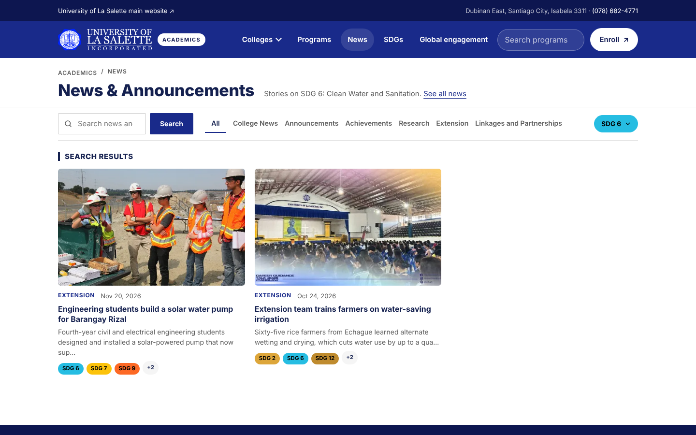
  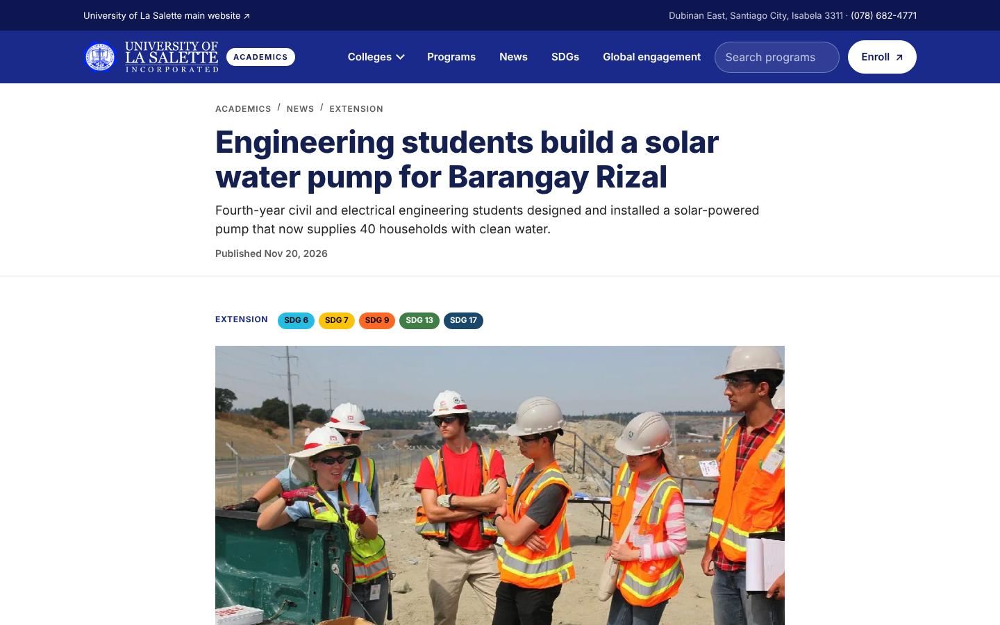
  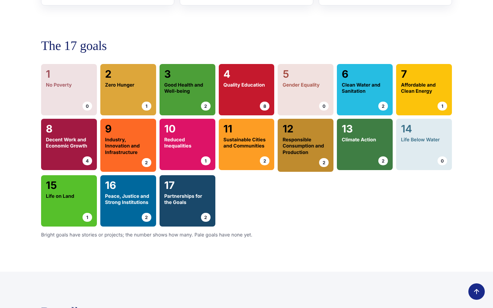
  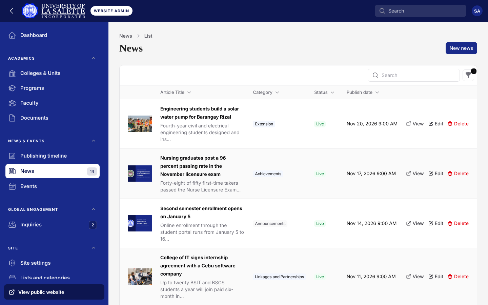
  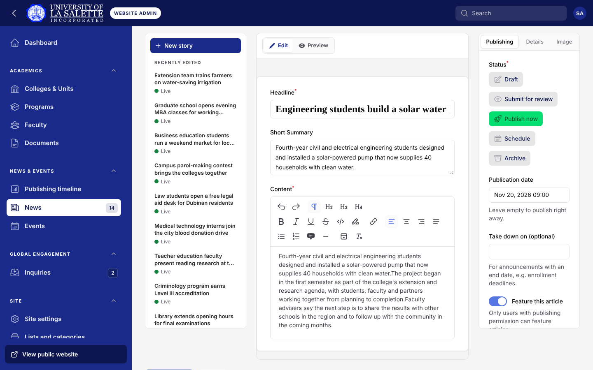
  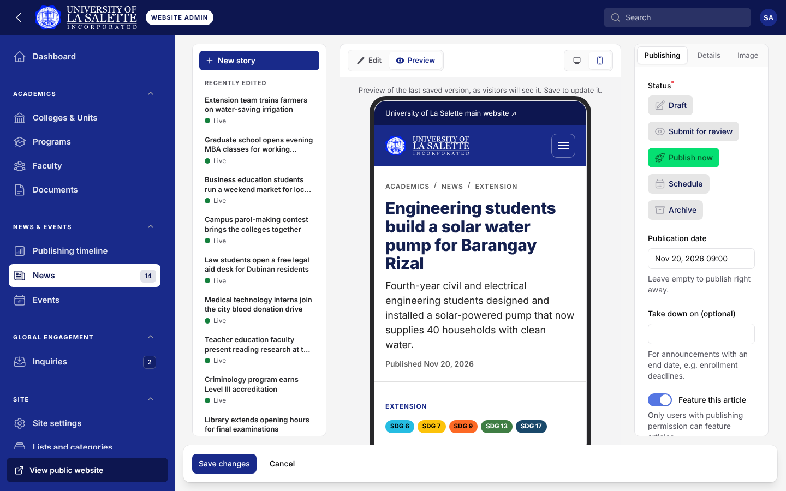
</p>

<p align="center">
  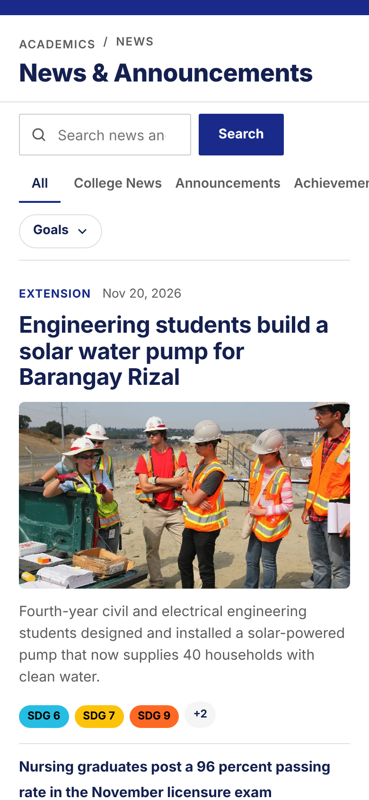
  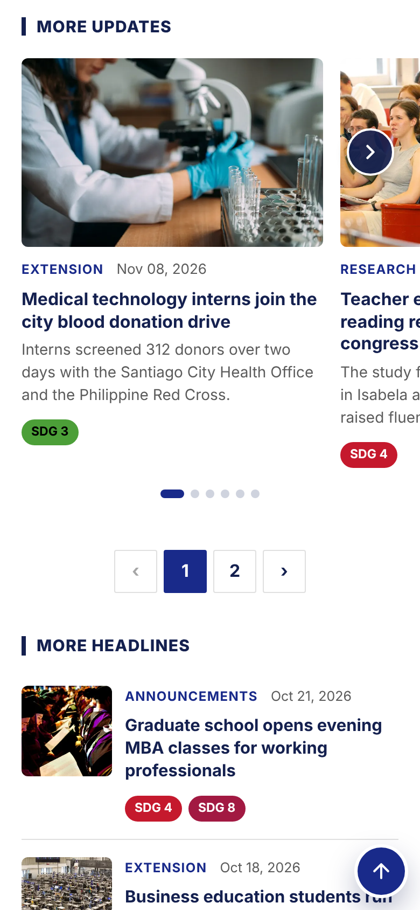
  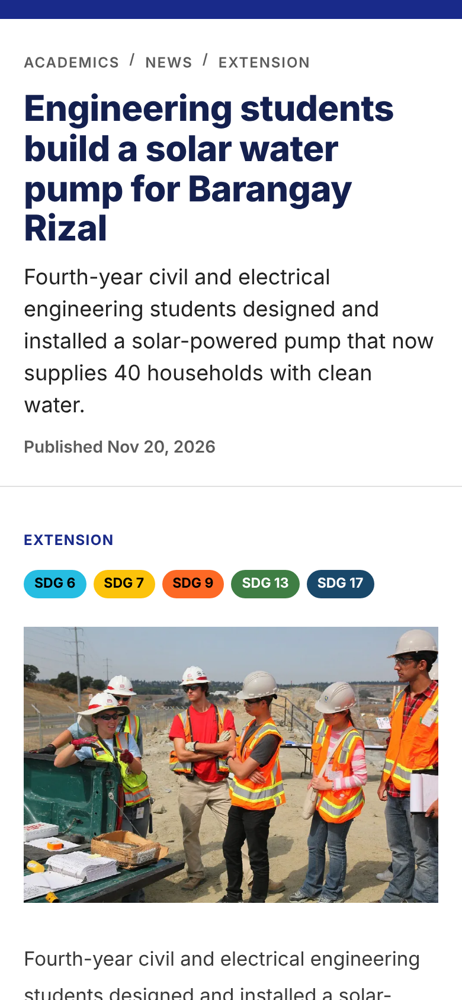
  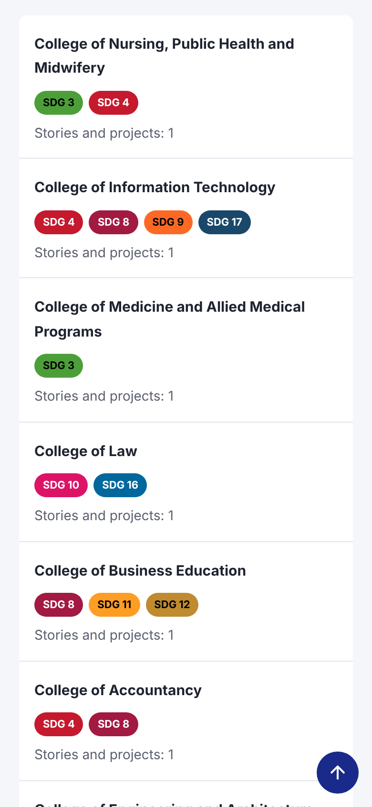
</p>

Built on the same stack as the main site: Laravel 12, PHP 8.4, Filament 5, MySQL.
Styles are plain CSS in `public/css/`. The site's own scripts (`resources/js/site.js`) are built with Vite: `npm ci && npm run build`
(needs Node.js; the built files in `public/build` are not in git). The production build obfuscates them.

## Install

```bash
cp .env.example .env              # set APP_URL, DB_* (a new database, e.g. uls_academics), MAIN_SITE_URL
php artisan key:generate
php artisan migrate               # tables + roles: super_admin, admin, editor, college_admin
php artisan db:seed               # site settings and lists, then colleges, programs, deans from the current ULS website
php artisan storage:link
php artisan thumbs:warm           # WebP thumbnails of the seeded photos
npm ci && npm run build           # site scripts into public/build (run again after every update)

php artisan make:filament-user                 # first administrator
php artisan permission:assign-role super_admin 1   # 1 = that user's id
```

Suggested address: `academics.uls.edu.ph`. Point the main website's **Academics** menu there.

## Public site

| URL | Page |
|---|---|
| `/` | Academics home: program search, quick links, stats, all colleges, featured programs, news and events |
| `/programs` | Program finder (level, college, degree type, accredited) |
| `/programs/{slug}` | Program: overview, objectives, curriculum, careers, admission, accreditation, FAQs, apply |
| `/colleges/{slug}` | College page (structure below) |
| `/colleges/{college}/{department}` | Department page |
| `/news`, `/news/{slug}` | College news; `?college=<slug>&sdg=<1-17>` filters |

### College page structure (modeled on bcu.edu.ph/coe)

1. **Header**: college name, headline, short description, *Our programs* and *Partners and linkages*
   buttons; side card with program count, dean, and research cluster with agenda link
2. **Numbers**: programs, partners, SDGs supported, stories published
3. **About**: vision, mission, goals, objectives, YouTube video, dean's message
4. **What you can study at {college}**: program cards with code, majors, *Program details* and *Ask about this program* (email)
5. **Our research cluster**: emblem, name, description, coordinator, agenda and repository links,
   research highlights, focus areas with SDG badges
6. **Who we work with**: partner cards (period, type, description, SDGs, links) and a linkages list
7. **What these linkages mean for you**: up to four student cards
8. **Extension and the SDGs**: the 17 goals with story counts (each links to that goal's news), extension projects
9. **Faculty**, facilities and downloads
10. **News and articles**, upcoming events, enrollment call to action

Every section is hidden until it has content, so a college can go live early.
In the admin, the college form has one tab per section, in the same order.

## Global Engagement & Linkages (global.uls.edu.ph)

Part of this app, with the same admin. Without `GLOBAL_DOMAIN` it is served at `/global`; set
`GLOBAL_DOMAIN=global.uls.edu.ph` in `.env` (and point that DNS name at this server) to serve it on its
own subdomain. Academics pages then stay on `APP_URL`'s host and `/global` redirects to the subdomain.

- **Partners**: each college's partner list (college page → Partners) plus the university-wide list in
  Site settings → Global engagement. A partner is entered once and shows on both sites.
  "Local or international" comes from Lists and categories → Partner reach.
- **Texts, sections, cards, questions, form choices**: Site settings → Global engagement.
- **Stories**: published news in the categories chosen there (default: Linkages and Partnerships, Extension).
- **Inquiries**: the "Let's connect" form saves to Admin → Global engagement → Inquiries (badge = new ones).
  No CSRF token, because the page is cached for everyone; a rate limit (5 per 10 minutes) and a hidden
  trap field keep spam out.

## Accessibility (WCAG 2.2 AA)

The public pages and the admin were checked at desktop and phone widths for contrast (SDG badges use the
text color that passes on each official SDG color), image alt text, link, button and form labels,
heading order, landmarks, focus rings and 24 px touch targets. axe (WCAG 2.2 AA) reports no violations on any
public page or on 18 admin pages. Screen reader checks (the browser's accessibility tree and a virtual screen
reader): every search form, navigation and landmark has its own name, the page title is inside the main area,
SDG labels are read once. Keyboard: the skip link moves focus to the content, and every control can be reached
and shows a focus ring. To re-check after design changes:

```bash
pip install playwright && playwright install chromium   # once
python3 tools/wcag_check.py https://academics.uls.edu.ph / /programs /colleges/college-of-law
```

For a second opinion, run the free axe DevTools or WAVE browser extension on the same pages.

**Light only.** The public site and the admin have one light theme and no colour-mode switch; pages stay
light when the device is set to dark. The colours are variables at the top of `public/css/academics.css`.

## Everything on the site is managed in the admin

The database is the single source of truth. Nothing the visitor sees is written in the templates:

| Admin screen | What it controls |
|---|---|
| **Site → Site settings** | Site and university names, logo, address, phone, links (main website, enrollment, admission); header menu, colleges menu, search box, enroll button; footer text and link columns; home page title, introduction, quick links, numbers and sections; college page sections, numbers, labels; program page sections and labels; program finder, news page, call to action, 404 page; screen reader labels; admin name; page cache and speed measurement settings |
| **Site → Lists and categories** | Academic levels, degree types, news categories, document categories, and the 17 SDGs with their colors. Every dropdown, filter, badge and label comes from here |
| Colleges, Programs, Faculty, Documents, News, Events | The content itself |

Page sections (home, college and program pages) can be **reordered, hidden and renamed** in Site settings;
headings accept placeholders such as `:college` and `:short`. Numbers (stats) are counted live from the database.
Any save or delete in the admin is visible on the next page view, including through the page cache.

`php artisan db:seed --class=SiteContentSeeder` fills only settings and list entries that do not exist yet,
so it is safe to run after updates; it never overwrites edits.

What stays in code, on purpose: the page *templates* (how a section looks), the publishing workflow
(Draft, Review, Scheduled, Published, Archived, because the scheduler depends on it), the kinds of
list (a new kind needs code that uses it), the admin panel's own interface wording, and Google's Core Web Vitals limits.

## Security

Every response from Laravel carries security headers (`App\Http\Middleware\SecurityHeaders`): Content-Security-Policy,
`X-Content-Type-Options: nosniff`, `X-Frame-Options: SAMEORIGIN`, `Referrer-Policy`, `Permissions-Policy` (camera, microphone,
location and payment off), `Cross-Origin-Opener-Policy`, and HSTS on HTTPS in production. `X-Powered-By` is removed.

- **Content-Security-Policy:** public pages run only this site's scripts and inline scripts carrying the page's nonce
  (`nonce="{{ Vite::cspNonce() }}"` on every `<script>` in Blade). The admin needs `'unsafe-inline'` and `'unsafe-eval'`
  for Filament and Alpine. It starts in report-only mode (`CSP_REPORT_ONLY=true`): open the main pages and the admin,
  check the browser console for "Content Security Policy" messages, then set `CSP_REPORT_ONLY=false` to enforce it.
- **Scripts:** `npm run build` obfuscates the site's own scripts (`javascript-obfuscator`, settings in `vite.config.js`; no source
  maps). This only makes them harder to read: browsers still receive and run them, so they must never hold secrets.
  `OBFUSCATE=false npm run build` makes a readable build for debugging. If the build is missing, pages still work without
  their scripts and a warning is logged.
- **Behind a proxy:** set `TRUSTED_PROXIES` (the proxy's IP, or `*`), so Laravel sees HTTPS and visitors' IPs.

Production server (XAMPP); these are server settings, not part of the repository:

| Where | Setting |
|---|---|
| `.env` | `APP_ENV=production`, `APP_DEBUG=false`, `SESSION_SECURE_COOKIE=true`, `TRUSTED_PROXIES=...`, `SESSION_DRIVER=file`, `CACHE_STORE=file` (or `redis`) |
| `apache/conf/extra/httpd-default.conf` | `ServerTokens Prod` and `ServerSignature Off` (Apache name only, no version or OS) |
| `php/php.ini` | `expose_php = Off`; `zend_extension=opcache` and `opcache.enable=1` (PHP keeps compiled code in memory) |
| After every update | `composer install --no-dev --optimize-autoloader`, `npm ci && npm run build`, `php artisan migrate --force`, then `php artisan optimize` (config, routes, views, events and Filament cached; run it again after any `.env` change), `php artisan cache:clear` (cached pages would otherwise keep the old layout for up to 10 minutes) and `php artisan thumbs:warm` (photo thumbnails for images copied in by hand; uploads in the admin get theirs when saved) |
| Apache virtual host | `DocumentRoot` pointing at the project's `public/` folder, so `/.env`, `/.git` and `/vendor` cannot be opened |
| HTTPS (the proxy, or Apache's SSL virtual host) | `Strict-Transport-Security: max-age=31536000; includeSubDomains` |

## Performance

- **Page cache**: finished public pages are kept ready (Site settings → Admin and performance, default 10 minutes).
  The cache key changes on every admin save or delete, and a page never outlives the next scheduled change
  (a story going live or down, an event ending). Browsers get `304 Not Modified` when nothing changed.
  Settings, lists and the colleges menu are cached the same way.
  With `CACHE_STORE=file` and `SESSION_DRIVER=file` a cached page runs no database query at all
  (with `database` it ran 7: 4 cache reads and 3 for the session), about 25% faster to the first byte.
  `redis` works too; use it when several servers share the site.
- **Database**: indexes for every public query; a page built fresh runs 8–20 queries and a cached page none;
  lazy loading is blocked outside production, so a missing eager load (N+1) fails in development and tests.
- **Images**: cards and headers use WebP thumbnails at 480 and 960 px (a 221 KB photo becomes a 31 KB card image),
  with `srcset`, fixed width/height (no layout shift) and lazy loading below the fold; the header photo is
  preloaded. Uploads larger than 1920 px are shrunk in the browser before upload. Thumbnails are made when an
  image is saved in the admin; `php artisan thumbs:warm` makes any that are missing (e.g. photos copied in by hand).
- **CSS per page**: a core stylesheet plus a small one for the page type (college, program, finder, news cards).
  News pages take only the main website's rules they use (`news.css`, 13 KB instead of 97 KB).
  No JavaScript framework on the public site: one small built script (`resources/js/site.js`, about 4 KB compressed).
- **CDN**: set `ASSET_URL` to a pull CDN in front of the site; all CSS, images, thumbnails and uploads load from it.
  `public/.htaccess` already sets long browser caching for versioned CSS/JS and images, plus compression.
- **Smooth loading**: page-to-page transitions in supporting browsers, skeleton cards while finder results load,
  image placeholders, server-side search, filters and paging.
- **Admin**: normal page loads. Filament's SPA mode is off: with it, the browser's Back button sometimes
  showed an admin page without its styles.
- **Core Web Vitals**: a share of real visits (Site settings, default 25%) reports LCP, INP, CLS, FCP and TTFB.
  The dashboard shows the 75th percentile for the last 7 days, for phones and computers, colored by Google's limits.
  Measurements are kept 90 days. No cookies or personal data.

Measured locally on 5 public pages, phone profile (4× slower CPU, ~1.6 Mbps, 150 ms latency):
largest element shown in 1.1–1.5 s (before: 1.4–2.3 s), 20–40% fewer bytes, layout shift 0.

## Publishing news (schedule, review, take down)

Each story has a status: **Draft**, **Submit for review**, **Publish now**, **Schedule** or **Archive**,
and optional **Take down on** date. Users without publishing rights (editors, and college
admins if you remove their `publish_news` permission) can only save drafts and submit them for review.

**News & Events → Publishing timeline** shows every story as a bar from its publish date to its
take-down date, grouped by college and colored by status, with events alongside. Drag a bar
(or focus it and press Alt + ← / →) to move it by days. Stories not scheduled yet are listed below.

**The news editor** (News → New or Edit) has three panes, like a page builder: recently edited stories and
**New story** on the left; the article (headline, summary, content) on a canvas in the middle; Publishing, Details
and Image tabs on the right. **Preview** shows the last saved version as the real article page, at desktop or phone
width, drafts included (`/admin/news/{id}/preview`, only for people who may edit that story, never indexed or cached).
Save and Cancel stay in view, and the admin warns before leaving a form with unsaved changes. On screens narrower
than 1280 px the story list is hidden; on phones the panes stack.

Admin lists are data grids with the same search, filters, sorting and paging as before. On tablets and small
laptops the row actions become icons and less important columns are hidden.

Scheduled stories appear on the website on time by themselves. To keep the admin status labels
current, add Laravel's scheduler to the server's crontab once:

```
* * * * * cd /path/to/uls-academics && php artisan schedule:run >> /dev/null 2>&1
```

Long content (college goals, facilities, program pages, news) uses one rich text editor with
the toolbar of the requested template: undo/redo, paragraph and H2–H4, bold, italic, underline,
strikethrough, code, highlight, link, alignment, lists, quote, divider, collapsible details and
clear formatting. H1 is left out because the page title is the H1. Content written earlier in
Markdown still displays correctly and becomes rich text the first time it is edited.

How these choices compare with WordPress, Contentful, Sanity and HubSpot: `docs/CMS-BENCHMARK.md`.

## Who edits what

| Role | Can edit |
|---|---|
| `super_admin` | Everything, including users and roles |
| `admin` | All colleges, programs, faculty, events, documents, news |
| `editor` | News drafts |
| `college_admin` | Only the college set on their user (**Users → Assigned College**): profile and every page section, departments, programs, accreditations, faculty, events, documents, college news |

Changes are recorded in **Activity Logs**.

## Content checklist per college

Headline and short description · vision, mission, goals, objectives · dean photo, title and message ·
banner photo and seal · YouTube video · college email · per program: code, summary, duration,
objectives, curriculum PDF, careers, FAQs · research cluster (name, emblem, coordinator, agenda link),
highlights and focus areas · partners and linkages · student benefits · extension projects with SDGs ·
faculty list · facilities · accreditation certificates.

## Design preview for the deans

The deans approve the design before the content is collected. Empty sections are hidden, so with no content
yet a college page is mostly blank. Sample content fills every section:

```bash
php artisan db:seed --class=CollegeDesignPreviewSeeder   # every college, department and program page
php artisan db:seed --class=NewsDesignPreviewSeeder      # the news pages
```

- Only empty fields are filled. Whatever a college or program already has (dean, mission, admission
  requirements...) stays as it is.
- Every sample starts with **[SAMPLE]** and says what belongs there, so the pages double as a guide for the
  content request. Each college also gets two sample departments, three sample faculty (after the real
  ones), two upcoming events and two downloads.
- A dean who signs in can type over a sample in the admin; the real text stays when the samples are removed.

When the real content is in (or before going live):

```bash
php artisan academics:remove-design-preview   # clears every field still showing [SAMPLE], deletes sample records
php artisan news:remove-design-preview
```

In lists (partners, highlights, projects...) only the sample items are removed. Load the samples on a local
or staging copy, not on the live site.
